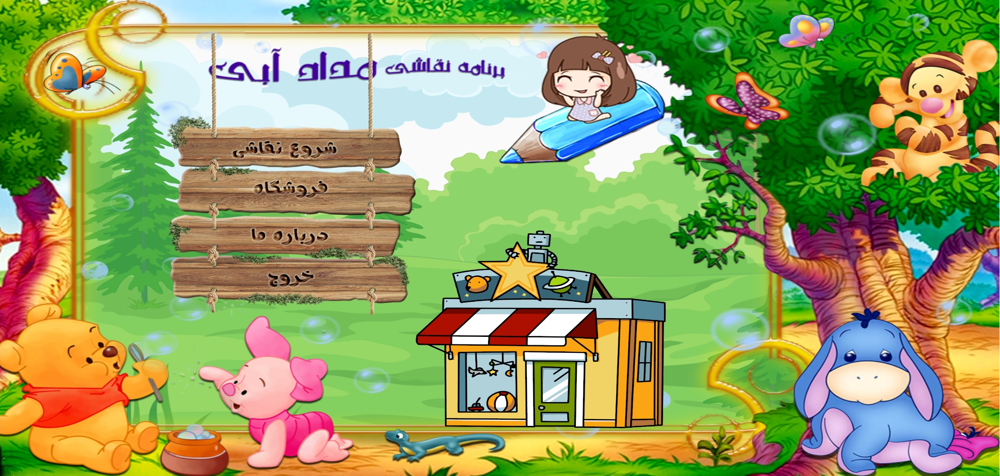
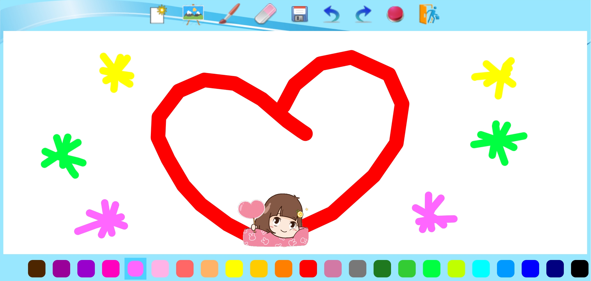
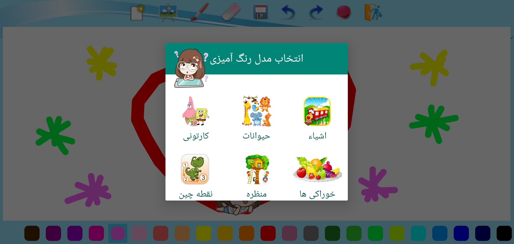

  
  
  

<h1>
  
  &nbsp; Blue Pencil
</h1>

**A Creative Drawing & Coloring App for Children**

Blue Pencil is a fun and interactive Android application designed for children to explore their creativity through drawing and coloring.

With a simple, colorful, and child-friendly interface, the app provides an enjoyable space for kids to express their imagination and create their own artwork.

## ✨ Features

- Interactive drawing and coloring activities
- Child-friendly and intuitive interface
- A variety of pictures to color
- Fun interactive character
- In-app purchases

## 🛠️ Technologies & Tools

- **Language:** Java
- **Platform:** Android SDK
- **UI Development:** XML Layouts
- **Backend & Analytics:** Firebase Analytics
- **Monetization:** In-App Billing
- **Development Environment:** Android Studio

## 📥 Download

[Download the latest APK](https://github.com/sasemanmanzar/blue-pencil-app/releases/latest)

## 🔒 Source Code

The source code is maintained in a private repository and is not publicly available.

---

## 👩‍💻 Developer

**Sara Aseman-Manzar** · Independent Android Developer
